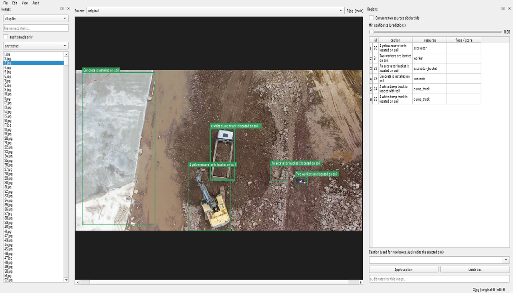

# SiteSight

Grounded construction-site understanding from drone images: region descriptions, a bounding box for each described object, and a structured site summary.

**Status: milestone M8 (monitoring and drift detection on top of the M7 service).** See [PLAN.md](PLAN.md) for scope, model choice and milestones, [DATASHEET.md](DATASHEET.md) for what the data is and its limits, [AUDIT.md](AUDIT.md) for the label-quality audit, and [DATA_LICENSES.md](DATA_LICENSES.md) for licences and citation.

## What exists so far
| Milestone | What | Where |
|---|---|---|
| M1 | VIA parser, validator, COCO-style schema, resumable verified download | `sitesight/data/` |
| M2 | Caption-field parser (99.63% coverage), near-duplicate groups, leakage-free split, datasheet | `sitesight/data/`, [`reports/m2/`](reports/m2/) |
| M3 | PyQt6 review tool (GT / prediction boxes, confidence filter, side-by-side comparison, label editing with undo, schema export) and the audit analysis code | `sitesight/viewer/`, `sitesight/data/audit.py` |
| M4 | Evaluation harness (AP, recall@IoU, ECE, BLEU/CIDEr/METEOR, field accuracy) and zero-shot OWLv2 / Florence-2 baselines | `sitesight/eval/`, `sitesight/baselines/`, [`reports/m4/`](reports/m4/README.md) |
| M5 | LoRA fine-tuning of Florence-2-base (Colab T4), failure classification | `sitesight/train/`, `sitesight/eval/gallery.py`, [`reports/m5/`](reports/m5/README.md) |
| M6 | Active learning: random vs uncertainty vs uncertainty+diversity (3 seeds): about 238 images vs 283 for random to reach 90% of full-data caption accuracy | `sitesight/active/`, [`reports/m6/`](reports/m6/README.md) |
| M7 | ONNX fp32/int8 export, FastAPI + batch CLI, Dockerfile: on a 2-vCPU Colab CPU cold p50 85 s (PyTorch) vs 12.1 s (ONNX fp32) vs 9.5 s (int8, 574 MB vs 1,242 MB); strict field accuracy within 2 regions of 300; 76% identical captions under int8 | `sitesight/serve/`, [`reports/m7/`](reports/m7/README.md) |
| M8 | Request log, image-quality stats, KS + MMD drift tests, HTML report, alert exit codes: whole-batch degradations caught from batch size 40 (blur, darkening, rescale), false alarms 0-1% on seen sites; 25%-contaminated batches need ~80 images; mild JPEG/noise mostly missed; new sites alert | `sitesight/monitor/`, [`reports/m8/`](reports/m8/README.md) |

## Zero-shot results (validation split, 215 images, T4 GPU)

| Model | Protocol | mAP@0.5 | Recall@0.5 | ECE |
|---|---|---|---|---|
| OWLv2-base | `detection` (all classes asked everywhere) | 7.9 | 50.8 | 0.047 |
| OWLv2-base | `given_phrases` | 24.1 | 50.8 | 0.049 |
| Florence-2-base | `given_phrases` | 16.3 | 27.5 | 0.101 |
| Florence-2-large | `given_phrases` | 21.5 | 33.8 | 0.088 |
| **Florence-2-base + LoRA (M5)** | `given_phrases` | **39.2** | 46.6 | 0.432 |

Florence-2 zero-shot region descriptions name the right resource only 14% to 18% of the time and almost never use the dataset's caption template or give a count. The two protocols are **not** comparable with each other, the labels are incomplete and use group boxes, and these are single deterministic runs without confidence intervals: read [`reports/m4/README.md`](reports/m4/README.md) before quoting any number. On the test split (run once) the fine-tuned model scores mAP@0.5 34.0 and recall@0.5 46.5 against OWLv2's 30.2 and 57.5, and region captions name the right resource 71.8% of the time. Fine-tuning made confidence much worse calibrated (ECE 0.43 to 0.46). Details: [`reports/m5/README.md`](reports/m5/README.md). Quantised rows will be added later.

The audit itself needs a person: `reports/m3/audit_sample.json` fixes the 100 images, and the agreement numbers will exist only after they are labelled (see [AUDIT.md](AUDIT.md)).

## Review tool


*Screenshot of the tool on a real image (`3.jpg`) with its original labels. Image and annotations: Bang & Kim, Mendeley Data, CC BY 4.0 ([DATA_LICENSES.md](DATA_LICENSES.md)).*

Each panel shows one source: the original ground truth, your edit layer, or a model's predictions (`--predictions a.json b.json`, format in `sitesight/data/predictions.py`). Tick *Compare* to put two sources side by side with synchronised zoom. Boxes are drawn, moved and resized with the mouse; captions autocomplete from the dataset's phrases and are re-parsed into resource, count, colour and state on every edit; everything is exported back in the SiteSight schema and validated before writing.

## Quickstart
```powershell
uv sync --group viewer                       # dev tools + PyQt6 (no torch)
uv run python scripts/download_data.py --data-dir sitesight_data
make data fields                             # parse + caption fields   (embeddings/curation: see Makefile)
uv run pytest                                # 180 tests, about 5 s
uv run pytest -m viewer                      # GUI tests (offscreen Qt)
make view                                    # open the review tool
```
Heavy steps run in Colab. For the M4 baselines, build a token-free notebook (the code is embedded, no GitHub token needed), upload it to Colab, pick a T4 GPU and Run all:

```powershell
uv run python scripts/build_colab_notebook.py --out colab/sitesight_m4_colab.ipynb
```
(`notebooks/01_data_splits.ipynb` for M2 is written but has not been run in Colab.)
